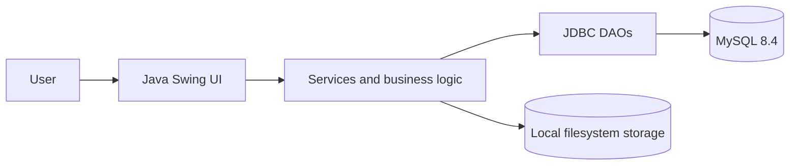

# DevSphere

### Build. Collaborate. Track. Grow.

[](https://www.oracle.com/java/)
[](https://docs.oracle.com/en/java/javase/21/docs/api/java.desktop/module-summary.html)
[](https://www.mysql.com/)
[](https://docs.oracle.com/en/java/javase/21/docs/api/java.sql/module-summary.html)
[](https://maven.apache.org/)

DevSphere is a pure Java desktop platform for developer collaboration and project intelligence. It combines developer profiles, project and file management, issue tracking, and transparent contribution analytics in one Java Swing application.

Repository: <https://github.com/Shibanhafiz/DevSphere>

## Project overview

DevSphere was developed as an academic Java desktop application at AITM, Bhatkal. It is intended for student developers and small teams that need a shared place to organize projects, discuss issues, manage files, and review recorded collaboration activity. Unlike a basic project list, it connects project work, issue history, team membership, profiles, and contribution statistics while keeping the implementation local, inspectable, and database-backed.

## Feature showcase

- **Authentication and security:** registration, BCrypt password hashing, login, sessions, validation, and database-backed credentials supplied through environment variables.
- **Developer profiles:** editable biographies, headlines, skills, social links, visibility, completion indicators, and profile previews.
- **Project management:** project creation/editing, statuses, ownership, membership, project details, and permission checks.
- **Project file management:** upload, download, delete, size/type validation, local storage, and project-member access checks.
- **Issue tracking:** bugs, tasks and features with priorities, statuses, assignees, due dates, comments, and activity history.
- **Contribution intelligence:** recorded activities, configurable points, score breakdowns, recent activity, leaderboard, project analytics, and a real-data contribution heatmap.
- **Dashboard and analytics:** Swing navigation for dashboard, profile, projects, issues, and contributions.

## Screenshots

No application screenshots are currently stored in this repository. Add real screenshots under `screenshots/` after running the application; do not use mock images or private data. Suggested filenames are:

`screenshots/login.png` · `screenshots/dashboard.png` · `screenshots/profile.png` · `screenshots/project-details.png` · `screenshots/issue-details.png` · `screenshots/contribution-heatmap.png`

See [docs/SCREENSHOTS.md](docs/SCREENSHOTS.md) for capture guidance.

## Technology stack

| Technology | Purpose | Version/source |
|---|---|---|
| Java | Application language and runtime | 21 (`maven.compiler.release`) |
| Java Swing | Desktop user interface | JDK 21 `java.desktop` |
| MySQL | Relational persistence | 8.4 target server |
| JDBC | Database access API | JDK 21 `java.sql` |
| MySQL Connector/J | MySQL JDBC driver | 9.1.0, from `pom.xml` |
| Maven | Dependency management and build | `pom.xml` |
| BCrypt | Password hashing and verification | jbcrypt 0.4 |
| Java I/O/NIO | Local project-file storage and safe paths | JDK 21 |
| JUnit Jupiter | Unit tests | 5.11.0, test scope |

## Architecture



The application is organized into models, DAOs, services, configuration, and Swing UI panels. Database initialization is additive and idempotent; it does not reset existing records. Project files are stored locally, while metadata and application data are stored in MySQL.

## Installation and setup

### Prerequisites

- Java 21 on `PATH`
- Maven on `PATH`
- MySQL 8.4 server
- VS Code with a Java extension pack (optional)

### Clone and open

```powershell
git clone https://github.com/Shibanhafiz/DevSphere.git
cd DevSphere
code .
```

### Create the database

Create the empty database once; the application creates or migrates its tables at startup:

```sql
CREATE DATABASE devsphere CHARACTER SET utf8mb4 COLLATE utf8mb4_unicode_ci;
```

### Configure environment variables

The application reads `DEVSPHERE_DB_URL`, `DEVSPHERE_DB_USER`, and `DEVSPHERE_DB_PASSWORD`. The URL defaults to `jdbc:mysql://localhost:3306/devsphere`. Optional file-storage settings are also supported. Copy `.env.example` as a reference; the application reads operating-system environment variables, not the file automatically.

PowerShell example:

```powershell
$env:DEVSPHERE_DB_URL = "jdbc:mysql://localhost:3306/devsphere"
$env:DEVSPHERE_DB_USER = "your_mysql_user"
$env:DEVSPHERE_DB_PASSWORD = "your_mysql_password"
$env:DEVSPHERE_STORAGE_DIR = "devsphere-storage"
$env:DEVSPHERE_MAX_FILE_SIZE_MB = "25"
```

Never commit real credentials.

### Build and run

```powershell
mvn clean package
mvn dependency:copy-dependencies
java -cp "target/classes;target/dependency/*" com.devsphere.Main
```

On first launch, register a user, sign in, and use the navigation panel to create projects, add members, manage issues/files, and review contribution data.

## Project structure

```text
DevSphere/
├── pom.xml
├── README.md
├── .env.example
├── docs/
├── screenshots/
└── src/
    ├── main/java/com/devsphere/
    │   ├── Main.java
    │   ├── DatabaseConnection.java
    │   ├── DatabaseTest.java
    │   ├── config/
    │   ├── dao/
    │   ├── model/
    │   ├── service/
    │   └── ui/
    └── test/java/com/devsphere/
```

## Testing

Automated unit tests:

```powershell
mvn test
mvn clean test
```

Package verification:

```powershell
mvn clean package
```

The automated tests cover authentication, profile, and project service behavior. A live MySQL server and configured environment variables are required for database startup, integration testing, and full manual UI verification. See [docs/DATABASE.md](docs/DATABASE.md).

## Future enhancements

Possible future work includes live database integration tests, moving remaining database refreshes off the Swing event-dispatch thread, a public profile directory, structured skill proficiency data, CI checks, and file checksums/version history. These are not presented as completed features.

## Project information and license

DevSphere is an academic Java desktop application project associated with AITM, Bhatkal, intended to demonstrate software engineering and collaboration-platform concepts. No `LICENSE` file is currently present; add an institution-approved license before distributing the repository as an open-source project.

## GitHub presentation suggestions

Suggested repository description: `A Java Swing developer collaboration platform featuring project management, issue tracking, file management, and contribution analytics.`

Suggested topics: `java`, `java-swing`, `mysql`, `jdbc`, `maven`, `desktop-application`, `project-management`, `developer-tools`
