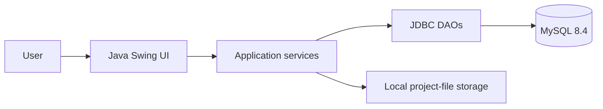

# DevSphere architecture

DevSphere is a Java 21 desktop application. The UI is Java Swing, persistence uses JDBC and MySQL, and project files use Java I/O/NIO on the local filesystem. There is no web server or browser frontend.

## Package responsibilities

- `com.devsphere.Main`: application entry point.
- `config`: additive database initialization and migrations.
- `model`: domain objects and session data.
- `dao`: prepared-statement database operations.
- `service`: validation, permissions, authentication, scoring, and file rules.
- `ui`: Swing frames, dialogs, panels, and navigation.
- `DatabaseConnection`: environment-based JDBC connection configuration.

## Security boundaries

Database credentials come from environment variables. Passwords are stored as BCrypt hashes. DAOs use prepared statements, and project operations enforce membership/ownership rules in service or DAO code. File paths are normalized and validated before local storage access.

Some database refreshes still run synchronously from Swing event handlers; file operations already use `SwingWorker`. This is a known optimization opportunity, not a change made by this documentation pass.
